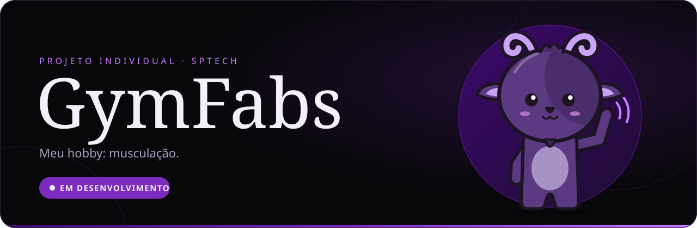
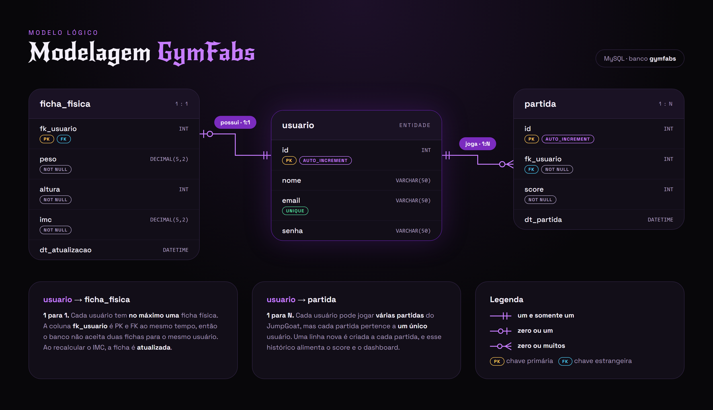
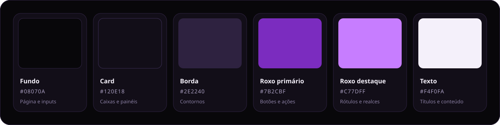

<div align="center">



<br>


**[Sobre](#-sobre)** · **[Funcionalidades](#-funcionalidades)** · **[JumpGoat](#-jumpgoat)** · **[Banco de dados](#-banco-de-dados)** · **[Tecnologias](#-tecnologias)** · **[Como rodar](#-como-rodar)** · **[Autor](#-autor)**

</div>

---

## ◆ Sobre

A **GymFabs** é um site sobre o meu hobby favorito, a **musculação**, desenvolvido como **Projeto Individual** na **SPTech — São Paulo Tech School**.

Na página inicial eu conto como a musculação entrou na minha vida, desde a infância até a primeira academia e quem eu me tornei. Também mostro o meu **kit de treino** (músicas, alimentação, suplementos e exercícios favoritos) e as minhas **inspirações**.

Quem cria uma conta pode jogar o **JumpGoat**, um minigame autoral sobre saúde. Cada partida fica salva no banco e aparece numa **dashboard** com recorde, média, gráficos e conquistas. O site também tem uma **calculadora de IMC** que guarda a ficha física do usuário.

> [!NOTE]
> As telas são feitas do zero com HTML, CSS e JavaScript puros. O back-end usa a API **web-data-viz** (Node.js + Express) com banco **MySQL**.

---

## ◆ Funcionalidades

| | Tela | O que tem | Status |
|:-:|---|---|:-:|
| 🏠 | **Página inicial** | Minha história (como tudo começou, infância, primeira academia, quem eu me tornei), meu kit de treino, inspirações e parceiros de treino | 🟣 Em andamento |
| 📝 | **Cadastro** | Nome, e-mail e senha, com validação de e-mail e medidor de força de senha em tempo real. Salva o usuário no banco | ✅ Funcionando |
| 🔐 | **Login** | Autentica e-mail e senha no banco e guarda a sessão do usuário | ✅ Funcionando |
| 🐐 | **JumpGoat: home** | Apresenta a história do jogo e leva para jogar ou para a dashboard | ✅ Funcionando |
| 🎮 | **JumpGoat: jogo** | Minigame de pulo. O score de cada partida é salvo automaticamente | ✅ Funcionando |
| 📊 | **Dashboard** | Recorde, média de score, total de partidas, conquistas por pontuação e gráficos das últimas 10 e das 5 melhores partidas | 🟣 Em andamento |
| ⚖️ | **Calculadora de IMC** | Calcula o IMC, mostra a faixa de classificação, compara com o valor anterior e salva a **ficha física** (peso, altura e IMC) | ✅ Funcionando |

<details>
<summary><b>📝 Cadastro: medidor de força de senha</b></summary>

<br>

A senha ganha 1 ponto para cada critério atendido:

- contém **número**
- tem **8 caracteres ou mais**
- mistura letras **maiúsculas e minúsculas**
- contém **caractere especial** (`! @ # $ % & *`)

| Pontos | Força | Pode cadastrar? |
|:-:|---|:-:|
| 1 | **FRACA** | ❌ |
| 2 | **MÉDIA** | ❌ |
| 3 | **FORTE** | ✅ |
| 4 | **MONSTRA** | ✅ |

O e-mail é considerado válido quando contém `@` e `.`.

</details>

<details>
<summary><b>⚖️ Calculadora de IMC: ficha física</b></summary>

<br>

- Ao abrir a página, os campos de **peso** e **altura** já vêm preenchidos com a ficha salva, e o último resultado aparece na tela.
- Ao calcular, a página mostra a faixa (abaixo do peso, normal, sobrepeso ou obesidade) e se o IMC **subiu ▲** ou **baixou ▼**.
- Ao clicar em **Atualizar ficha**, os dados são salvos. Cada usuário tem uma única ficha, que é atualizada a cada vez (relacionamento **1:1**).

</details>

---

## ◆ JumpGoat

> *"Saúde não é presente. É uma dívida. Se paga com suor, foco e disciplina. Não pagou? Vira Mollux."*

Os **Mollux** deixaram os robôs fazerem tudo e perderam os músculos. Agora sobrevivem roubando a força dos outros, e o alvo é a **Luna**. O jogador ajuda a Luna a fugir, pulando cada obstáculo no caminho.

O jogo é uma crítica ao **sedentarismo** e à **má alimentação**: quem treina e se cuida escapa desse destino.

- **Como jogar:** clique em **START** e aperte qualquer tecla para pular.
- **Score:** sobe enquanto a Luna continua correndo. Quando ela é pega, a partida termina e o score é salvo.
- **Conquistas na dashboard:** Pegando o ritmo (500) · Aquecimento (1.000) · Em forma (3.000) · Anti-Mollux (5.000) · Cabra de aço (7.500) · Lenda da Luna (10.000)

---

## ◆ Banco de dados

<div align="center">



</div>

| Tabela | Relacionamento | Descrição |
|---|---|---|
| `usuario` | — | Contas criadas no cadastro (nome, e-mail único e senha) |
| `partida` | **1:N** com `usuario` | Cada usuário joga várias partidas. Guarda o score e a data de cada uma |
| `ficha_fisica` | **1:1** com `usuario` | Cada usuário tem no máximo uma ficha. A `fk_usuario` é **PK e FK ao mesmo tempo**, o que garante o 1:1 |

O script completo está em [`src/database/script-tabelas.sql`](src/database/script-tabelas.sql).

<details>
<summary><b>🔌 Rotas da API</b></summary>

<br>

| Método | Rota | O que faz |
|:-:|---|---|
| `POST` | `/usuarios/cadastrar` | Cria um usuário |
| `POST` | `/usuarios/autenticar` | Faz o login |
| `POST` | `/partidas/salvar` | Salva o score de uma partida |
| `GET` | `/partidas/kpis/:idUsuario` | Recorde, média e total de partidas |
| `GET` | `/partidas/ultimas/:idUsuario` | Últimas 10 partidas (gráfico de evolução) |
| `GET` | `/partidas/melhores/:idUsuario` | 5 melhores partidas |
| `POST` | `/imc/salvar` | Cria ou atualiza a ficha física |
| `GET` | `/imc/ficha/:idUsuario` | Busca a ficha física do usuário |

</details>

---

## ◆ Tecnologias

| Camada | Tecnologia | Uso |
|---|---|---|
| Estrutura |  | Todas as telas |
| Estilo |  | Visual das telas e animações do jogo |
| Lógica |  | Validações, IMC, JumpGoat e dashboard |
| Gráficos |  | Gráficos da dashboard |
| API |   | Rotas de usuários, partidas e IMC (**web-data-viz**) |
| Banco de dados |  | Usuários, partidas e fichas físicas |

<details>
<summary><b>🎨 Paleta de cores</b></summary>

<br>



</details>

<details>
<summary><b>📁 Estrutura de pastas</b></summary>

<br>

```
Projeto-individual---GymFabs/
├── app.js                  # servidor Express
├── docs/                   # imagem da modelagem do banco
├── public/                 # telas do site
│   ├── Index/              # página inicial
│   ├── Pagina Login/       # cadastro e login
│   ├── Jump-goat-home/     # home do JumpGoat
│   ├── JumpGoat/           # o jogo
│   ├── DashBoard/          # dashboard do jogador
│   └── CalculadoraIMC/     # calculadora de IMC
└── src/
    ├── database/           # conexão e script SQL
    ├── routes/             # rotas da API
    ├── controllers/        # regras de cada rota
    └── models/             # consultas ao banco
```

</details>

---

## ◆ Como rodar

Você vai precisar do **Node.js** e do **MySQL** instalados.

```bash
# 1. Clone o repositório
git clone https://github.com/oFabs-dev/Projeto-individual---GymFabs.git

# 2. Entre na pasta
cd Projeto-individual---GymFabs

# 3. Instale as dependências
npm install
```

**4.** No MySQL, execute o script [`src/database/script-tabelas.sql`](src/database/script-tabelas.sql) para criar o banco `gymfabs` e as tabelas.

**5.** Crie um arquivo `.env.dev` na raiz com os dados do seu banco:

```env
AMBIENTE_PROCESSO=desenvolvimento

DB_HOST=localhost
DB_DATABASE=gymfabs
DB_USER=seu_usuario
DB_PASSWORD=sua_senha
DB_PORT=3306

APP_PORT=3333
APP_HOST=localhost
```

**6.** Inicie o servidor:

```bash
npm start
```

**7.** Acesse `http://localhost:3333/Index/index.html` no navegador.

---

## ◆ Autor

<div align="center">

<a href="https://github.com/oFabs-dev">
  
</a>

### Fabricio Lima

Estudante da **SPTech — São Paulo Tech School**

[](https://github.com/oFabs-dev)

</div>

---

<div align="center">

Distribuído sob a licença **MIT**. Veja [`LICENSE`](LICENSE) para mais detalhes.

<sub>Feito com 💜 e muita série pesada.</sub>

</div>
