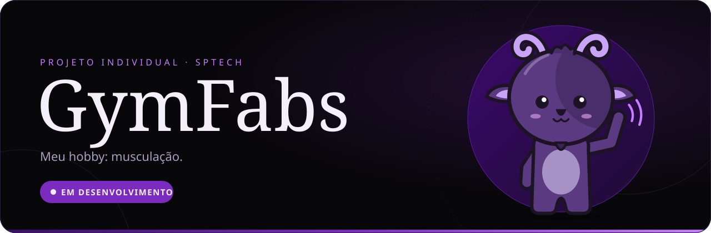

<div align="center">



<br>


**[Sobre](#-sobre)** · **[Funcionalidades](#-funcionalidades)** · **[Tecnologias](#-tecnologias)** · **[Como rodar](#-como-rodar)** · **[Autor](#-autor)**

</div>

---

## ◆ Sobre

A **GymFabs** é um site sobre o meu hobby favorito, a **musculação**, desenvolvido como **Projeto Individual** na **SPTech — São Paulo Tech School**.

Nele eu conto como a musculação entrou na minha vida, o que ela me ensinou e quem me inspira. O site também tem um **quiz** para testar o que você sabe de treino, uma página com os meus **favoritos** (músicas, alimentação e ficha de treino) e uma **calculadora de IMC**. Quem quiser pode criar uma conta e entrar com **cadastro e login**.

> [!NOTE]
> O projeto está em desenvolvimento ativo. As telas são feitas do zero com HTML, CSS e JavaScript puros, e o cadastro e o login vão usar a API **web-data-viz** (Node.js) com banco **MySQL**.

---

## ◆ Funcionalidades

| | Tela | O que tem | Status |
|:-:|---|---|:-:|
| 🏋️ | **Meu hobby** | Minha história na musculação: como tudo começou, a primeira academia, os valores que levo além do treino, as dificuldades que superei e as minhas inspirações | ⚪ Planejado |
| 🎮 | **Quiz GymFabs** | Mini game com visual arcade: tela inicial, perguntas de múltipla escolha sobre treino e tela de resultado com acertos x erros e desempenho por tema | ⚪ Planejado |
| ⭐ | **Meus favoritos** | Músicas para treinar, o que eu como antes e depois do treino e a minha ficha de treino favorita | ⚪ Planejado |
| ⚖️ | **Calculadora de IMC** | Recebe peso (kg) e altura (cm), calcula o IMC e mostra a faixa de classificação | 🟣 Em andamento |
| 📝 | **Cadastro** | Nome, e-mail e senha, com validação de e-mail e medidor de força de senha em tempo real | 🟣 Em andamento |
| 🔐 | **Login** | Acesso com o e-mail e a senha cadastrados | ⚪ Iniciado |

<details>
<summary><b>📝 Cadastro: medidor de força de senha</b></summary>

<br>

A senha ganha 1 ponto para cada critério atendido:

- contém **número**
- tem **8 caracteres ou mais**
- mistura letras **maiúsculas e minúsculas**
- contém **caractere especial** (`! @ # $ % & *`)

| Pontos | Força | Pode cadastrar? |
|:-:|---|:-:|
| 1 | **FRACA** | ❌ |
| 2 | **MÉDIA** | ❌ |
| 3 | **FORTE** | ✅ |
| 4 | **MONSTRA** | ✅ |

O e-mail é considerado válido quando contém `@` e `.`.

</details>

---

## ◆ Tecnologias

| Camada | Tecnologia | Uso | Status |
|---|---|---|:-:|
| Estrutura |  | Todas as telas | ✅ Em uso |
| Estilo |  | Visual das telas | ✅ Em uso |
| Lógica |  | Validações, IMC e quiz | ✅ Em uso |
| API |  **web-data-viz** | Cadastro e login | 🔜 Planejado |
| Banco de dados |  | Guardar os usuários cadastrados | 🔜 Planejado |

---

## ◆ Como rodar

Por enquanto as telas são só HTML, CSS e JavaScript, então não precisa instalar nada.

```bash
# 1. Clone o repositório
git clone https://github.com/oFabs-dev/Projeto-individual---GymFabs.git

# 2. Entre na pasta
cd Projeto-individual---GymFabs
```

**3.** Abra o arquivo da tela que quiser no navegador:

- `CalculadoraIMC/calculadoraIMC.html`
- `Pagina Login/cadastro.html`
- `Pagina Login/login.html`


## ◆ Autor

<div align="center">

<a href="https://github.com/oFabs-dev">
  
</a>

### Fabricio Lima

Estudante da **SPTech — São Paulo Tech School**

[](https://github.com/oFabs-dev)

</div>

---

<div align="center">

Distribuído sob a licença **MIT**. Veja [`LICENSE`](LICENSE) para mais detalhes.

<sub>Feito com 💜 e muita série pesada.</sub>

</div>
